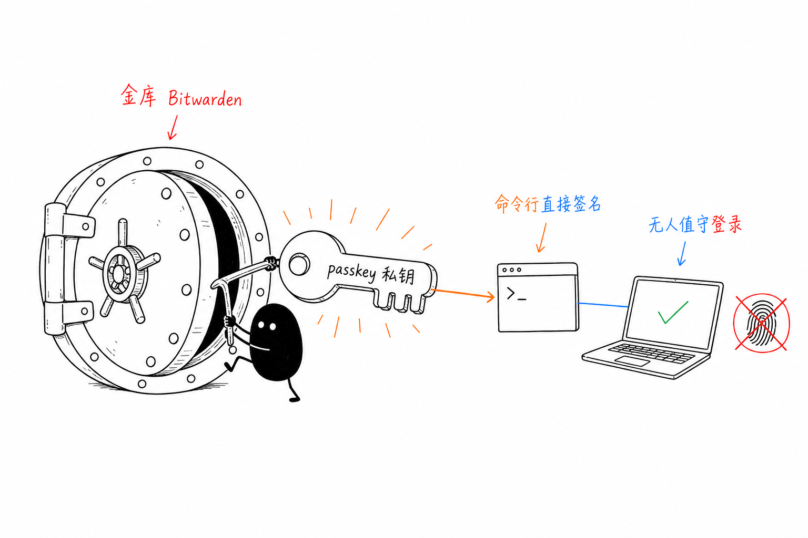

# bitwarden-use

## Profile data and attachments

Personal profile policy and synchronization are owned by
[profile-use](https://github.com/leeguooooo/profile-use). Infrastructure and runbooks
belong to memory-use; secret values belong to the vault. The first two workflows
can reference a vault entry rather than keeping another editable secret copy.

`bwu profile sync` is a compatibility alias that requires the installed profile-use
skill. Its `python3 scripts/profile_use.py sync` (Python 3.9+) copies a profile into your vault. It
creates native identity/card items, preserves every JSON section in secure notes,
and uploads document originals as encrypted attachments. It verifies the text by
reassembly and each attachment by downloading and checking its SHA-256. No plaintext
export, secret command arguments or source-file changes are needed.

```sh
bwu profile sync "$PROFILE_USE_DIR/personal.profile.json" --dry-run
bwu profile sync "$PROFILE_USE_DIR/personal.profile.json" --yes
```

The destination defaults to the `profile-use` folder. `--profile` and `--folder`
select another profile or destination; `--skip-attachments` explicitly omits files.
Re-running updates managed items and skips unchanged values/files. It refuses
duplicate names, unrelated entries, changed file hashes and paths outside the
profile's attachment directory. Changed files retain their earlier uploaded versions.
Missing files stop the operation before any write. The manifest is saved only after
all readback checks pass. No background schedule is installed.

`bwu add` accepts a single password line on piped stdin, with one optional terminal
LF or CRLF. Multiline input and private-key blocks are rejected before unlocking or
making a vault request, so a key cannot silently become a one-line password.
Use `bwu item put` with native SSH-key or secure-note JSON for multiline material.
The interactive editor still supports a first-line password followed by notes.

For native writes, send JSON via stdin (type 2 = secure note, 3 = card, 4 = identity, 5 = SSH key):

```sh
printf '%s' '{"name":"Example note","type":2,"notes":"Example text"}' |
  bwu item put - --folder profile-use --dry-run
# Pass --yes to create; --id UUID replaces the selected native payload/notes; fields change only when provided.
bwu attachment list ITEM_UUID                   # filenames masked
bwu attachment list ITEM_UUID --reveal
bwu attachment upload ITEM_UUID /private/file --dry-run
bwu attachment upload ITEM_UUID /private/file --yes
bwu attachment download ITEM_UUID ATTACHMENT_ID --output /private/new-file
bwu attachment download ITEM_UUID ATTACHMENT_ID --output - | consuming-command
```

`item put --id UUID --convert --yes` creates a new UUID when changing type.
It keeps the original, its history and any data there until you explicitly remove
it. Conversion with attachments/shared items is refused; migrate their files
explicitly. Ordinary `--id` updates refuse type changes because some servers accept
the request but retain the old type.

Attachment files are limited to 128 MiB. Downloads refuse overwrites, create files
with mode 0600, authenticate ciphertext before writing plaintext and use the normal
reveal authorization/audit. Shared-item writes and legacy keyless attachments are
not supported. An interrupted two-stage upload may leave metadata on the server;
inspect that item before retrying. The upgraded agent must be running for binary
key wrapping (`bwu stop-agent`, then `bwu unlock` after installing both binaries).

Version 0.7.0 is built for logging in from a browser agent: `login --domain --list` ranks the
accounts for a site by how recently you used them, an `_autotype` field describes a site's login
steps, `run` asks once per item, and clipboard copies are hidden from clipboard history and
cleared after 30 s. See [Logging in to websites](#logging-in-to-websites). Version 0.4.0 adds `run`: secrets go straight into a command's environment and never into your
terminal, logs or an AI agent's context. Version 0.3.0 puts a human in the loop: Touch ID before
Keychain unlock and before revealing items outside `reveal_folders`, an audit log of every
reveal, `fido2 get` masks the private key unless `--reveal`, and the agent drops keys when the
screen locks. See [Human confirmation and audit](#human-confirmation-and-audit-macos). Version
0.2.0 added safe field updates and masked reads. See [the offline command guide](docs/release.html).

```sh
bwu run --env GH_TOKEN='github token' -- gh api user   # inject, never print (preferred)
bwu get ITEM --json                            # masked by default
bwu get ITEM --field password --reveal          # explicit plaintext output
bwu login --domain example.com --name ITEM --reveal
bwu set ITEM --uri https://example.com --match host --dry-run
bwu set ITEM --totp SEED --yes
bwu unlock --keychain-store                    # macOS: one-time verified enrollment
bwu unlock --keychain
```

Scripts must add `--reveal` when consuming secrets and `--yes` when applying reviewed writes.

Without `--reveal`, `get` outputs the literal `[redacted]` with exit code 0 and a hint on stderr when a value is masked; use `--reveal` or `bwu run --env VAR=ITEM -- <command>` to consume the real value.
Empty values require `--allow-empty`; URI edits preserve unselected fields, passkeys and attachments.
Custom fields use exact names. Domain lookup never reveals credentials until exactly one item matches.

<p align="center">
  
</p>

`bitwarden-use` is a command line client for
[Bitwarden](https://bitwarden.com/) and self-hosted
[Vaultwarden](https://github.com/dani-garcia/vaultwarden) servers, with
first-class support for extracting **FIDO2 / passkey** credentials from your
vault — so you can sign WebAuthn logins **headlessly**, with no browser and no
fingerprint tap.

Unlike the official stateless CLI — which requires you to manually lock and
unlock and pass temporary keys around in environment variables —
`bitwarden-use` keeps a background agent (`bitwarden-use-agent`) that holds the
keys in memory, similar to the way `ssh-agent` or `gpg-agent` work. The client
talks to that agent, so commands can be used directly and handle logging in or
unlocking as needed.

## Installation

**Prebuilt binary (recommended)** — no Rust toolchain, no npm, no token:

```sh
curl -fsSL https://raw.githubusercontent.com/leeguooooo/bitwarden-use/main/install.sh | sh
```

This pulls `bitwarden-use` + `bitwarden-use-agent` from the latest
[GitHub Release](https://github.com/leeguooooo/bitwarden-use/releases) (macOS
arm64/x64, Linux arm64/x64), verifies the checksum, and installs into
`~/.local/bin`. Override with `BITWARDEN_INSTALL_DIR=/usr/local/bin`, or pin a
version with `BITWARDEN_VERSION=v0.1.0`.

**From source** — any platform with a Rust toolchain:

```sh
cargo install --locked --path .
```

Maintainers release with `scripts/release.sh 0.5.1`: it bumps the version, pushes the tag, waits for the release build and syncs the plugin marketplace (`--dry-run` to preview).

Both paths produce the two binaries `bitwarden-use` and `bitwarden-use-agent` and
require the
[`pinentry`](https://www.gnupg.org/related_software/pinentry/index.en.html)
program (to display password prompts). The installer also drops a short **`bwu`**
symlink so you can type `bwu fido2 list` instead of the full name.

**Upgrading** — `bitwarden-use upgrade` installs the latest release (CLI + agent,
sha256-verified, swapped in atomically, old pair kept on failure) into the
directory the running binary lives in, through `install.sh`; it refuses and
prints the right command for cargo, Homebrew or source installs. `--tag vX.Y.Z`
pins a version, `--skills` also refreshes this skill's own copies (Claude Code
plugin, git checkout), and `upgrade --check` / `upgrade --json` only report. A
running agent keeps the old version until `bitwarden-use stop-agent`. Once a day any command may print a one-line
`bitwarden-use X is available` notice on stderr (cached in
`~/.cache/bitwarden-use/update-check.json`, 2 s timeout); set
`BITWARDEN_USE_NO_UPDATE_CHECK=1` (or the family-wide `USE_NO_UPDATE_CHECK=1`)
to turn it off. Neither touches the vault or needs it unlocked.

**With the Claude Code plugin the CLI follows the plugin.** A SessionStart hook
([`hooks/sync-cli.sh`](hooks/sync-cli.sh)) compares the installed CLI with the
plugin's version and, when the CLI is older, installs exactly that release
(`upgrade --tag`, or `install.sh` for 0.4.x, which predates `upgrade`), logging to
`~/.cache/bitwarden-use/auto-upgrade.log`. The next command restarts the agent,
so the vault asks to unlock once. Off with `BITWARDEN_USE_NO_AUTO_UPGRADE=1` (or
`USE_NO_AUTO_UPGRADE=1`). For the plugin itself to update, turn on auto-update
for the marketplace: `/plugin` → Marketplaces → leeguooooo-plugins → Enable
auto-update (off by default for third-party marketplaces).

## Configuration

Configuration options are set using the `bitwarden-use config` command.
Available configuration options:

* `email`: The email address to use as the account name when logging into the
  server. Required.
* `sso_id`: The SSO organization ID. Defaults to regular login process if unset.
* `base_url`: The URL of the Bitwarden/Vaultwarden server to use. Defaults to
  the official server at `https://api.bitwarden.com/` if unset.
* `identity_url`: The URL of the identity server to use. If unset, will use the
  `/identity` path on the configured `base_url`, or
  `https://identity.bitwarden.com/` if no `base_url` is set.
* `ui_url`: The URL of the web UI to use. If unset, defaults to
  `https://vault.bitwarden.com/`.
* `notifications_url`: The URL of the notifications server to use. If unset,
  will use the `/notifications` path on the configured `base_url`, or
  `https://notifications.bitwarden.com/` if no `base_url` is set.
* `lock_timeout`: The number of seconds to keep the master keys in memory for
  before requiring the password to be entered again. Defaults to `3600` (one
  hour).
* `sync_interval`: The agent will automatically sync the database from the
  server at this interval (in seconds) while running. Set to `0` to disable.
  Defaults to `3600` (one hour).
* `pinentry`: The
  [pinentry](https://www.gnupg.org/related_software/pinentry/index.html)
  executable to use. Defaults to `pinentry`.

* `reveal_folders`: Comma-separated folders whose items any local process
  may reveal (`--reveal`, `code`, `login --domain --reveal`, `run`). Items
  elsewhere need Touch ID each time. Empty (default) keeps the old behaviour.
* `unlock_with_keychain`: `true` to unlock from the macOS Keychain after Touch
  ID instead of typing the master password (enroll once with
  `unlock --keychain-store`). Falls back to pinentry if that fails.
* `lock_on_screen_lock`: Drop the keys when the screen locks (default `true`,
  macOS; the screen locks on sleep).
* `require_touch_id`: `false` trusts this computer: no Touch ID before a
  Keychain unlock or a reveal outside `reveal_folders` (default `true`).
  Reveals are still audited. See below.
* `clipboard_clear_after`: Seconds a value copied with `--clipboard` stays on
  the clipboard (default `30`, `0` = never). It is cleared only if nothing else
  was copied since. On macOS copies are also marked
  `org.nspasteboard.ConcealedType`, so clipboard history apps (Pastyx, Maccy,
  Raycast, …) don't keep them.

### Human confirmation and audit (macOS)

A background agent that holds your keys is convenient, but any process running
as you can talk to it. 0.3.0 adds a human gate for the parts that matter:

* **Keychain unlock needs Touch ID** (login password as fallback) every time,
  both for `unlock --keychain` and with `unlock_with_keychain`.
* **Reveals outside `reveal_folders` need Touch ID.** Keep the secrets you let
  scripts or AI agents use in one folder (for example `memory`); everything
  else asks you first.
* **Every reveal is logged** to `~/Library/Logs/bitwarden-use/reveal.log`: time,
  command, item, field, folder, the process chain that asked, and how it was
  authorized. Never the value.
* **`fido2 get` hides the private key** unless `--reveal`; prefer
  `fido2 assert`, which signs without exporting it.
* **Screen lock drops the keys**, independent of `lock_timeout`.

For unattended automation on a computer you trust, turn the prompts off:

```sh
bwu config set require_touch_id false
```

The Keychain unlock and every reveal then go through without Touch ID, also
after the vault locked itself (idle timeout or screen lock). Reveals are still
written to the audit log, with `auth: "trusted-device"`. Anyone, and any
process, using your account on this computer can then read the whole vault
while it is unlocked or the Keychain entry exists; `bwu config unset
require_touch_id` turns the prompts back on.

The first Keychain unlock after installing 0.8.3 or later shows macOS's own
"bitwarden-use-agent wants to use your confidential information" dialog once:
enter your login password and choose **Always Allow**. Release binaries are
signed with the same Developer ID (Team ID `6ZPXG4KVVS`), so later upgrades do
not ask again. (Before 0.8.3 every upgrade asked: the Keychain identifies a
binary without a Team ID by its per-build hash.)

Suggested setup:

```sh
bwu config set reveal_folders memory
bwu config set lock_timeout 14400          # 4 h
bwu unlock --keychain-store                # type the master password once
bwu config set unlock_with_keychain true
```

### Profiles

`bitwarden-use` supports different configuration profiles, switched via the
`RBW_PROFILE` environment variable. Setting it to a name (for example,
`RBW_PROFILE=work` or `RBW_PROFILE=personal`) lets you switch between several
vaults — each uses its own separate configuration, local vault, and agent.

## Usage

Commands can generally be used directly, and will handle logging in or
unlocking as necessary. For instance, `bitwarden-use ls` will unlock the
password database before listing entries (but will not log in to the server),
`bitwarden-use sync` will log in before downloading the database (but will not
unlock it), and `bitwarden-use add` will do both.

Logging in and unlocking are only done as necessary, so running
`bitwarden-use login` when already logged in does nothing, and similarly for
`bitwarden-use unlock`. Use `bitwarden-use login --force` to sign in again
anyway, e.g. after the server revoked the saved login. When a refresh is
rejected (`invalid_grant`), the saved tokens are dropped but the offline vault
cache is kept: reads keep working from the cache, and the next
`bitwarden-use login` (or any write) asks for the master password again.
Explicitly lock the database with `bitwarden-use lock` or
`bitwarden-use stop-agent`. `bitwarden-use purge` logs out and **deletes the
offline cache** — the copy you still have when the server is down — so copy
it first if you might need it.

`bitwarden-use help` gives more information about the available functionality.

Run `bitwarden-use get <name>` to inspect a masked result; add `--reveal` to read the password.
Use `--full` or `--json` for structured fields, and `--field=<field>` for a built-in or exact custom field.
`--raw` remains supported as the JSON option. In addition to matching against the name,
you can pass a UUID to search for the entry with that id, or a URL to search
for an entry with a matching website entry.

*Note for users of the official Bitwarden server (at bitwarden.com)*: the
official server has a tendency to detect command line traffic as bot traffic.
To use `bitwarden-use` with it, first run `bitwarden-use register` to register
each device with the server. This prompts for your personal API key, which you
can find using the instructions
[here](https://bitwarden.com/help/article/personal-api-key/).

### Organizing entries into folders

```sh
bwu folder list --json                  # includes empty folders
bwu folder create 'Work' --dry-run
bwu folder create 'Work' --yes
bwu ls --fields id,name,folder
bwu move UUID1 UUID2 --to 'Work' --dry-run
bwu move UUID1 UUID2 --to 'Work' --yes
bwu move UUID1 --clear --dry-run         # return to no folder
```

Moves accept entry UUIDs only, so duplicate names cannot select the wrong
account. `--to` takes an exact folder name or its UUID; duplicate folder names
require a UUID. Create the destination first. Creating an already existing
unique name and moving entries already in the destination are no-ops.

The preview shows entry UUIDs, names and old/new folders. Folder operations
never decrypt passwords, TOTP seeds, notes, custom fields or passkey keys.
Moves preserve complete server ciphers and their attachments, guard against
concurrent folder changes, and send the server revision to reject stale writes.
Moving into a configured `reveal_folders` folder changes the entry's reveal
policy; the preview calls this out.

Writes require confirmation or `--yes`; `--dry-run` makes no vault changes.
Batch moves run sequentially and stop on the first failure. The error reports
the completed count and sync outcome; a failed request may have been accepted,
so check the synced state before retrying. Organization collections and sharing
permissions are separate from personal folders and are not changed.

### Importing from another password manager

`bitwarden-use import <file.csv>` adds the logins from a CSV exported by Apple
Passwords (the macOS Passwords app or Safari: File → Export All Passwords),
Google Password Manager (passwords.google.com or Chrome: Settings → Export
passwords) or 1Password 8 (File → Export, CSV). The format is recognized from
the header row; name, username, password, website, notes and one-time-password
setup are kept. Logins already in the vault with the same name and username are
skipped, so running it again only adds what is missing.

```sh
bwu import ~/Downloads/Passwords.csv --dry-run     # list what would be added
bwu import ~/Downloads/Passwords.csv --folder imported --yes
rm ~/Downloads/Passwords.csv                       # the export is plain text
```

### Logging in to websites

[chrome-use](https://github.com/leeguooooo/chrome-use) 1.5.155+ logs in with
your vault when `bwu` is installed:

```sh
chrome-use open https://github.com/login
chrome-use auth login --bwu              # account for the current page; Touch ID once
```

Underneath it uses two commands any tool can call:

```sh
bwu login --domain github.com --list     # masked candidates, most recently used first
bwu run --env U=bw:<uuid>#username --env P=bw:<uuid>#password -- <filler>
```

`--list` prints every login matching the site with `uses` and `last_used`,
counted from the reveal audit log, so the account you actually use comes first.
Values stay masked; nothing is revealed and nothing asks for Touch ID. `run`
then asks once for the item, however many of its fields it injects.

For sites whose login is not "username, password, submit", add a custom field
named `_autotype` to the item. The syntax is the same as
[rofi-rbw](https://github.com/fdw/rofi-rbw)'s: steps separated by `:`, made of
`username`, `password`, `totp`, `tab`, `enter`, `delay`, or the name of
another custom field. A two-page login is

```
username:enter:delay:password:enter
```

`login --domain` returns the parsed steps as `autotype` (step names only, so
they appear unmasked).

Passkeys work the same way. `login --domain` says how many the item has
(`passkeys`), and `run --env PK=bw:<uuid>#passkeys` hands them to a browser
automation as JSON for Chrome's virtual authenticator, so the site's own
WebAuthn ceremony signs with the vault key. chrome-use does this in
`auth login --bwu` (passkey as second factor) and `auth login --bwu --passkey`
(sign in with the passkey alone). The signature counter the site sees stays
the vault's (0 for a synced passkey), the same as the Bitwarden extension
reports.

### FIDO2 / passkeys

`bitwarden-use fido2` works with FIDO2 (passkey) credentials stored in your
vault:

* `bitwarden-use fido2 list` — list passkeys (entry name, rpId, credentialId).
* `bitwarden-use fido2 get <name>` — display a passkey, including its decrypted
  private key as base64url and as a PKCS#8 PEM document. The entry can be
  selected by name, URI, UUID, or by the credentialId of the passkey itself.

### SSH Agent

`bitwarden-use-agent` includes a built-in SSH agent for signing SSH
authentication challenges directly. Ensure the agent is running (unlock once),
then point your SSH client at its socket:

```sh
bitwarden-use unlock
export SSH_AUTH_SOCK="$XDG_RUNTIME_DIR/rbw/ssh-agent-socket"
```

If you're using a profile, the socket is located at
`"$XDG_RUNTIME_DIR/rbw-<profile>/ssh-agent-socket"`.

> The on-disk config, cache, and runtime directories are named `rbw` for
> compatibility, so an existing rbw/Vaultwarden login keeps working under
> `bitwarden-use` with no migration.

### 2FA support

`bitwarden-use` supports the following 2FA mechanisms:

* Email
* Authenticator App
* Yubico OTP security key

WebAuthn / Passkey and Duo are unsupported as 2FA mechanisms. If you only use
an unsupported mechanism, add a supported one to your account so the CLI can
authenticate; you can keep using your preferred mechanism with other clients.

<!-- use-family -->
## The `*-use` family

Small, composable CLIs that give an AI agent hands on one real thing. Same shape
everywhere: `curl … install.sh | sh` to install, `npx skills add leeguooooo/<name>`
to teach your agent, JSON on stdout.

| Repo | Gives your agent |
|---|---|
| [chrome-use](https://github.com/leeguooooo/chrome-use) | A real browser — logged-in sessions, forms, scraping, screenshots |
| [mail-use](https://github.com/leeguooooo/mail-use) | Email — read, search, send, triage across Gmail / QQ / 163 / any IMAP |
| [iphone-use](https://github.com/leeguooooo/iphone-use) | A real iPhone — tap, type, screenshot, pull on-device data |
| [wechat-use](https://github.com/leeguooooo/wechat-use) | WeChat on macOS — send messages, query contacts and history |
| [discord-use](https://github.com/leeguooooo/discord-use) | Discord — messages, channels, forums, webhooks (REST-only, Rust) |
| [cookie-use](https://github.com/leeguooooo/cookie-use) | Many logged-in accounts per site — capture, switch, apply sessions |
| [profile-use](https://github.com/leeguooooo/profile-use) | Your personal profile, safely — fill signup / KYC / checkout forms |
| [chatgpt-use](https://github.com/leeguooooo/chatgpt-use) | Your ChatGPT subscription as a coding-agent backend — no API key |
| [computer-use](https://github.com/leeguooooo/computer-use) | The macOS desktop itself |
| [pixcake-use](https://github.com/leeguooooo/pixcake-use) | Read-only PixCake probing — snapshot / diff / SQLite inspection |
